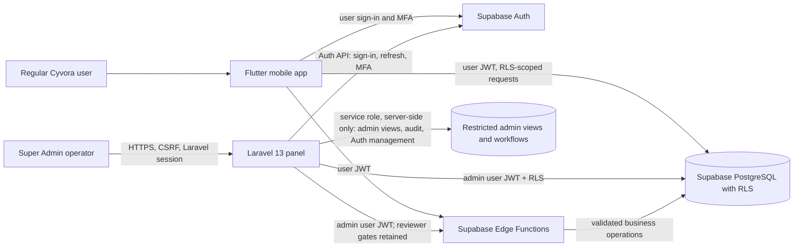

# Cyvora architecture map

**Updated:** 2026-11-23
**Scope:** Repository architecture and current implementation boundaries.
Remote Supabase deployment state, credentials, and live provider connectivity
have not been verified.

**Current hardening status:** All four privileged roles require a verified MFA
factor and AAL2 across Laravel, administrator-facing Edge Functions, and the
existing RLS MFA gate. Laravel performs first-login TOTP enrollment and
requires a fresh challenge before sensitive mutations. These source changes
and migrations have not been applied to a Supabase project; see the [full
security audit](CYVORA_FULL_SECURITY_AUDIT.md).

## System map

```text
Flutter mobile client
  ├─ Supabase Auth and MFA
  ├─ Dashboard screens and scan-history UI
  ├─ DashboardRepository (Supabase queries and Edge Function calls)
  ├─ On-device screenshot OCR
  └─ Android notification listener bridge
       └─ native listener queue -> explicit in-app review -> scan request

Supabase Edge Functions
  ├─ scam-intelligence
  │    ├─ scam analysis and optional AI provider routing
  │    ├─ scan persistence and assistant chat
  │    └─ trusted intelligence review/evaluation/release gates
  └─ family-invitations (family invite lifecycle)

Supabase PostgreSQL
  ├─ application data and Row Level Security policies
  ├─ ownership/family authorization helpers
  ├─ invitation and scan RPCs
  └─ versioned migrations

Laravel 13 Super Admin panel
  ├─ Supabase Auth sign-in, mandatory MFA enrollment/challenge, and role revalidation
  ├─ Fresh MFA reauthentication for sensitive mutations
  ├─ server-only privileged views and Auth admin operations
  ├─ user-JWT/AAL2 RLS dataset reads and trusted Edge Function moderation calls
  └─ append-only administrative audit and deletion workflows

GitHub Actions
  ├─ CI: Flutter dependency check, analysis, widget tests, Android debug APK
  │      and Supabase Node tests
  └─ Android release: tag/manual workflow, signing-secret validation,
         signed APK/AAB validation and GitHub Release publication
```

## Component responsibilities and boundaries

### Cross-component communication

Laravel is a separate, server-rendered administrator client. Its service-role
credential is used only server-side for narrowly scoped administrative reads,
Auth management, and audit/workflow storage. Privileged roles require a
verified factor and AAL2. Trusted-intelligence reads use an administrator user
JWT and RLS; review and release operations call the existing Edge Function
with its reviewer gates intact.



Supabase remains the shared application backend. Laravel does not replace
Flutter authorization, database RLS, or Edge Function business rules. It does
not send the service-role key to a browser or mobile client. Role values are
assigned in Supabase `app_metadata` by trusted server/CLI operations; editable
`user_metadata` is not an authorization source.

### Flutter

`flutter/lib/main.dart` initializes Supabase when both URL and publishable key
are configured. `AuthGate` observes Supabase Auth state, applies the client MFA
step-up gate, and passes the signed-in identity to the dashboard. The
`DashboardRepository` interface separates dashboard widgets from
`SupabaseDashboardRepository`, which reads user-scoped records and invokes the
two Edge Functions. `dashboard_screen.dart` contains the home, scan, history,
family, alerts, and profile flows. Screenshot text extraction is on-device;
the screenshot itself is not sent by the current analysis path.

### Supabase Edge Functions and database

`scam-intelligence` is the central server analysis entry point. Deterministic
analysis remains the baseline; AI and external URL reputation are optional.
The function validates request sizes, coordinates modules, persists scan
results, and uses server-side provider configuration. `family-invitations`
handles invitation operations using the service-role key only server-side.

Migrations define schemas, RLS, RPCs, quotas, provider health, and retention.
The production dashboard ledger was observed at
`202611150005_mfa_enforcement`; repository migrations
`202611150006_scan_history_retention.sql` and `202611170001`–`202611170005`
were not recorded as applied. Edge Function deployment revisions were not
verified. This makes repository state and production database state different;
no migration was run during this audit.

### Android and iOS

Android uses a native `NotificationListenerService`, not the default-SMS-app
role. It queues eligible notification title/text/package metadata in
app-private preferences. Flutter exposes a user-initiated review list; the
selected item is sent to the server only after the user chooses to scan it.
This is not automatic background analysis. iOS uses the Flutter app and
Supabase Auth callback URL scheme; no equivalent notification-listener
implementation was identified.

Each notification event has a stable scan idempotency key. A server-side
reservation prevents duplicate scan persistence when the app retries after
process loss, and replays the prior result; deleting scan history prevents an
old pending notification from recreating it. Migration
`202611170005_notification_scan_idempotency.sql` requires `pg_cron` for
idempotency-record cleanup and has not been applied or database-tested.

Configured identities differ: Android namespace/application ID
`com.example.cyvora_mobile`; iOS bundle ID `com.example.cyvoraMobile`.
Both retain `com.example` identifiers. They were not changed because
production identity must be confirmed by the owner first. iOS build and
signing were not tested on this Windows host.

### Laravel Super Admin panel

`laravel/` implements separate administrator authentication, role/permission
checks, request throttles, encrypted token storage, per-request role and
suspension revalidation, privacy-limited dashboard/data views, moderation
calls, and privileged-action audit logging. The Supabase service-role
credential remains in server configuration. The panel deliberately omits
private scan content, family communications, invite secrets, and AI secrets.
Setup and role details are in [`laravel/README.md`](../laravel/README.md).

The repository includes migration
`202611230002_super_admin_panel.sql` for restricted admin views, append-only
audit logs, deletion requests, and trusted-intelligence reviewer policy
updates. Migration `202611230003_require_mfa_for_admins.sql` changes the
existing MFA gate to require a verified factor and AAL2 for `super_admin`,
`admin`, `moderator`, and `support_admin`, while preserving opt-in MFA for
regular users. The `scam-intelligence` function recognizes `super_admin` without
removing its reviewer separation and dataset release checks. Migration
application, remote Auth configuration, Edge Function deployment, and
end-to-end behavior against a Supabase project remain unverified.

## Current assessment

- Flutter + Supabase remains the regular-user application architecture; no
  redesign is indicated.
- `DashboardRepository` is a useful data boundary, but
  `dashboard_screen.dart` and `dashboard_repository.dart` carry many unrelated
  features and are large. Incremental feature-level extraction could improve
  maintainability after the higher-priority deployment and verification gaps
  are resolved.
- Laravel is the security-critical Super Admin system; its implementation and
  deployment must be verified independently from the Flutter app.
- MFA recovery remains an operator-controlled break-glass process; there is no
  panel endpoint that bypasses the second factor.
- CI validates local/client code and mocked/static backend behavior. It does
  not run PostgreSQL migrations, RLS integration tests, deployed Edge Function
  tests, live provider calls, iOS builds, or device notification tests.
- Production readiness is not established. See
  [the full audit](CYVORA_FULL_CODE_AUDIT.md),
  [security audit](CYVORA_SECURITY_AUDIT.md), and
  [test results](CYVORA_TEST_RESULTS.md).

## Follow-up — 2026-11-23

The 2026-11-23 worktree changes scan-history retention. The repository no longer
deletes records older than 120 days during history reads; migration
`202611230001_preserve_scan_history.sql` cancels the scheduled cleanup and
drops its function. The privacy notice now describes retention until the user
deletes history or requests account deletion. This migration has not been
executed against a local or staging database, and the production ledger was
not rechecked after its last 2026-11-17 observation.

Locally built Android release artifacts are blocked at identity verification:
APK and AAB signatures are valid but do not match the expected identity
enforced by `flutter/scripts/validate_android_release.py`. Protected CI
signing secrets were not accessed, so the workflow's signing identity remains
unverified. Build and test results are recorded in
[CYVORA_TEST_RESULTS.md](CYVORA_TEST_RESULTS.md); no signing identity was
changed.

### Historical pre-implementation Laravel audit — 2026-11-23

The findings in this subsection describe the scaffold before the Super Admin
implementation above; they are retained as audit history and are superseded
by the current architecture description.

The product owner confirms Laravel's intended role is Cyvora's Super Admin
panel. Source and runtime route inspection show that the implementation is
still a framework scaffold: five routes are registered, with no `/admin`,
login, or logout routes; one route is the public welcome page and one is
Laravel Boost's development browser-log endpoint. No app Supabase client,
service-role credential, dashboard data source, or admin action was found.
This is an incomplete security-critical component, not an unused component.

No role-separated authorization test can be performed until authentication,
admin roles, and administrative routes exist. The two current Laravel tests
cover only the scaffold. `config/session.php` now defaults secure cookies on
when `APP_ENV=production`, preserves the local non-HTTPS default, and still
honors `SESSION_SECURE_COOKIE`; the local, production, and explicit-override
configurations were checked with Artisan.

The production behavior of Boost's browser-log endpoint remains conditional:
it is a development dependency, but the deployment install mode was not
verified. Ensure production uses `composer install --no-dev` and verify the
endpoint is absent from the deployed route list.
