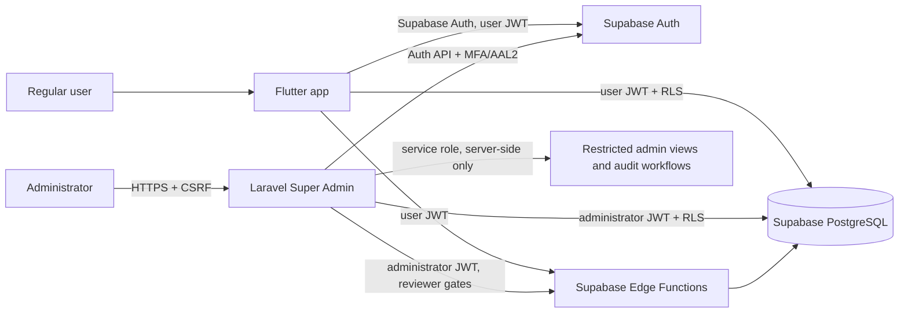

# Cyvora full security audit

**Assessment:** 2026-11-23
**Repository:** `XueShadow/Cyvora`
**Inspected branch/commit:** `fix/mlkit-release-crash` / `6ab63fe`
**Scope:** Flutter client, Laravel Super Admin panel, Supabase migrations and
Edge Functions, Android notification handling, and release/CI controls.
**Production changes:** None. No production credentials were read, no
migrations were applied, and no deployment was performed.

## Executive summary

The Laravel application is an intentional, security-critical Super Admin
panel, not an unused or disconnected component. The reviewed source preserves
the Flutter + Supabase architecture and adds a server-rendered administrator
surface that uses Supabase Auth, restricted database views, user-JWT/RLS reads,
and existing Edge Function moderation gates.

One high-severity source gap was confirmed: privileged accounts without an
already verified MFA factor were allowed to pass the old MFA checks at AAL1.
The current worktree closes this gap by requiring factor enrollment and AAL2
in Laravel, privileged Edge Function requests, and the database MFA gate. It
also adds short-lived MFA reauthentication for sensitive Laravel mutations.
The fix is covered by local tests, but its SQL and hosted Supabase behavior
remain unverified.

The specialist review reported no other confirmed vulnerability in its
reviewed changes. This is not a penetration test. Production readiness is
still blocked by unverified database/RLS behavior, unverified deployed Edge
Function revisions, an Android signing-identity mismatch recorded in the
release checks, and unavailable iOS/device verification.

## Findings

| # | Severity | Finding | Status |
|---|---|---|---|
| 1 | 🟠 HIGH | Privileged accounts without a verified factor could access administrative paths at AAL1. Affected the Laravel gate, Edge Function MFA helper, and database `mfa_access_allowed()` policy. | Fixed in the current worktree; Supabase migration/function deployment not verified. |

### Remediation details

- Laravel now requires all four server-assigned roles (`super_admin`, `admin`,
  `moderator`, `support_admin`) to enroll a TOTP factor before an authenticated
  panel session is created. Existing verified TOTP and phone factors require
  AAL2.
- Sensitive account, family, moderation, deletion, dataset-release, and
  administrator-role mutations require a fresh MFA challenge within five
  minutes. Challenges are session-bound, rate-limited, and CSRF-protected.
- The Edge Function MFA helper rejects privileged requests with no verified
  factor and distinguishes enrollment-required from AAL2-required responses.
- Migration `202611230003_require_mfa_for_admins.sql` changes the existing
  restrictive MFA gate to require both a verified factor and AAL2 for the
  four privileged roles. Regular users retain the existing opt-in MFA
  behavior.
- Flutter's privileged-session gate blocks accounts that have not completed
  enrollment and supports both TOTP and SMS challenges.

## Security review by area

### Administrator authentication and authorization

- There is no public administrator registration route. Trusted provisioning
  assigns the role in Supabase `app_metadata`; editable `user_metadata` is not
  an authority source.
- Server-side role and account-suspension state are revalidated on panel
  requests. Each route also enforces its permission server-side.
- Passwords remain in Supabase Auth. Laravel stores encrypted Supabase access
  and refresh tokens in its session, rotates the session ID during
  authentication transitions, and clears local state at logout.
- Login, MFA, password-reset, and general panel requests are throttled.
  Password-reset responses do not disclose whether an account exists.
- Laravel's web middleware provides CSRF protection. Production session-cookie
  security depends on HTTPS and the secure-cookie/session configuration being
  correct in the deployed environment.
- MFA recovery is intentionally not an application bypass. A lost-factor
  recovery must be handled through a trusted, out-of-band operator procedure;
  the recovered account must enroll and verify a new factor before access.

### Dashboard and data exposure

- Dashboard values are queried from Supabase-backed views and tables. The
  dashboard reports unavailable data as an error rather than substituting
  simulated values.
- User, scan, family, report, provider-history, usage, security-event, and
  audit views use pagination or bounded summaries.
- The panel limits scan data to metadata and risk fields. It does not expose
  raw message bodies, family communications, invitation tokens, passwords,
  authentication tokens, or provider secrets.
- The implementation does not claim subscriptions, per-user billing, provider
  connectivity, or live provider configuration where no supported backend
  contract exists.

### Supabase integration and administrative actions

- Laravel communicates with Supabase through a server-side service layer with
  timeouts, response validation, bounded pagination, and status-only error
  logging.
- The service-role key is read from server configuration and is not placed in
  Blade, Vite, Flutter, or browser requests. Operations that need the service
  role remain dependent on Laravel route permissions and audit controls.
- Trusted-intelligence reads use the administrator's user JWT and RLS.
  Moderation/release actions call the existing Edge Function and preserve its
  reviewer separation and dataset release gates.
- Family administration exposes membership/invitation metadata and security
  summaries, not private communications.
- Administrative writes produce audit records with actor, role, action,
  target, outcome, request ID, and bounded non-sensitive metadata. Audit
  immutability is defined in the Supabase migration but has not been tested
  against a deployed database.

### Flutter, Edge Functions, and release safety

- Flutter uses Supabase user sessions and RLS for user-scoped data; editable
  profile metadata is not used to grant server privileges.
- AI-provider analysis and external reputation checks remain explicit user
  choices; provider secrets stay server-side. Local Node tests exercise
  redaction, request budgets, provider failure handling, and safe verdict
  behavior. These are mocks/regressions, not live-provider verification.
- Android notification previews are opt-in, locally encrypted, bounded, and
  subject to user-configurable retention. User-approved scans now carry an
  event-scoped idempotency key, so server retries replay a saved result rather
  than duplicating scan history. The database migration and pgTAP assertions
  are added but not run; device/OEM behavior has not been tested.
- Android release workflow policy tests do not establish that the configured
  signing key matches the owner's authorized identity. Prior local artifact
  checks found that the APK/AAB signer did not match the validator's expected
  identity. No release should be published until the owner confirms the
  authorized signing configuration.

## Verification and limitations

Current local verification:

- Laravel: 28 tests, 125 assertions passed.
- Flutter: analysis passed; 67 tests passed.
- Supabase Node tests: 98 passed, including privileged-MFA and notification
  idempotency cases.
- Android debug APK build passed.
- Pint formatting/check and live Supabase/PostgreSQL checks are reported in
  [test results](CYVORA_TEST_RESULTS.md).

Not verified:

- PostgreSQL/pgTAP execution, SQL migration application, or hosted RLS.
- Supabase Auth factor enrollment, recovery, JWT claims, or hosted Edge
  Function behavior.
- Current deployed migration ledger or Edge Function revisions.
- Live AI/reputation provider connectivity, spend limits, or provider
  retention settings.
- Physical Android/OEM notification behavior or iOS build/signing.
- Android production signing identity and GitHub protected-environment
  configuration.

The local pgTAP security-boundary suite includes administrator MFA
assertions, and the notification-idempotency migration has a separate 14-test
pgTAP suite. Neither was run because Supabase CLI/PostgreSQL tooling is
unavailable. The Deno runtime is also unavailable.

## Architecture

See the [Super Admin guide](CYVORA_SUPER_ADMIN_GUIDE.md),
[Supabase integration](CYVORA_SUPABASE_INTEGRATION.md), and
[deployment guide](CYVORA_SUPER_ADMIN_DEPLOYMENT.md) for the concrete
permissions, data boundary, and safe staging sequence.
